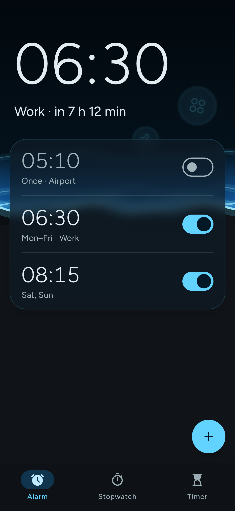
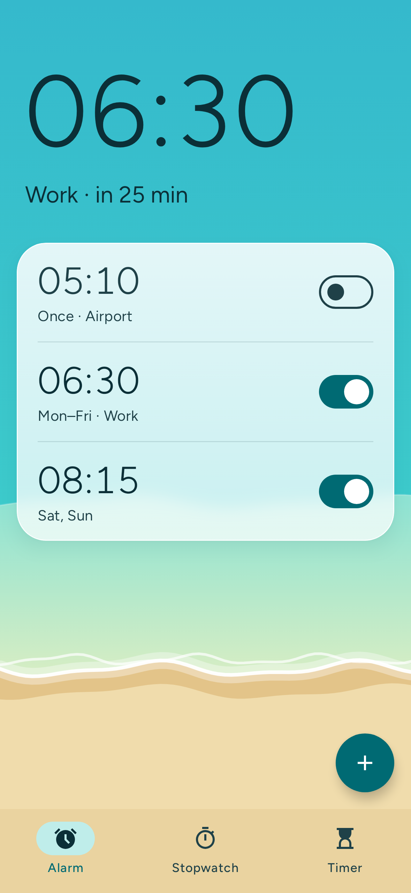
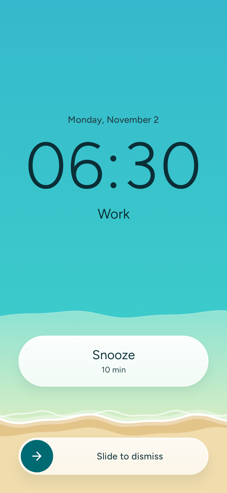
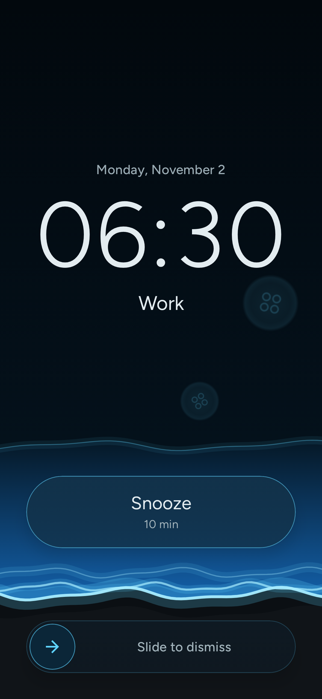

# Tide

[](https://github.com/MartinThoma/android-alarm/actions/workflows/ci.yml)
[](LICENSE)
[-3DDC84?logo=android&logoColor=white)](docs/requirements.md)
[](gradle/libs.versions.toml)
[](https://developer.android.com/compose)

A free and open-source Android clock app: alarm, stopwatch and timer.
No ads, no tracking, no network access.

The screen is a beach seen from above: the closer your next alarm, the higher the tide.

Requires Android 15 (API 35) or newer. See [docs/requirements.md](docs/requirements.md).

> **Work in progress.** Alarms ring, snooze and dismiss, but have not been tested on a real phone yet. There is no alarm editor yet.

In English, German, French and Spanish; each can also be chosen as the app's own language in Android's settings.

## Screenshots

| Evening, 7 h before the alarm | Morning, 25 min before | Ringing | Ringing at night |
|:---:|:---:|:---:|:---:|
|  |  |  |  |

The screenshots come from the app itself, rendered by its Robolectric tests. Update them with `./gradlew :app:recordRoborazziDebug`.

## Build

Requires JDK 21 and the Android SDK (`ANDROID_HOME` or `local.properties` with `sdk.dir`).

```sh
./gradlew assembleDebug      # build
./gradlew installDebug       # install on a connected device
./gradlew spotlessApply      # format
./gradlew lint testDebugUnitTest
./gradlew :app:recordRoborazziDebug   # update the README screenshots
```

## Licence

[GPL-3.0-or-later](LICENSE). Bundled assets keep their own licences: the Figtree font is under the [SIL Open Font License 1.1](core/designsystem/FIGTREE-OFL.txt), the Material Symbols icons under Apache-2.0.
